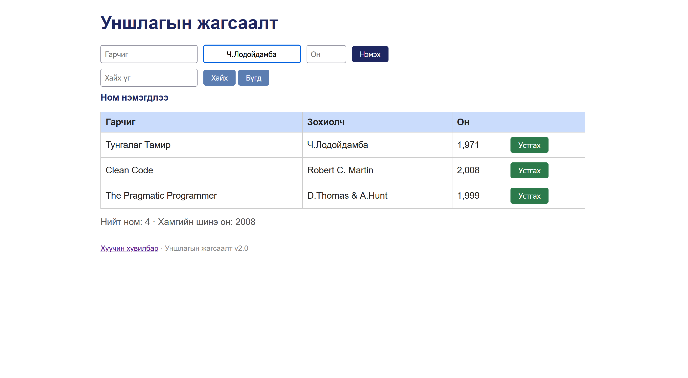

# BUG-01: «Нийт ном» тоолуур хүснэгтэд буй номын тооноос зөрж, 3 ном байхад 4 гэж харагддаг

Орчин: Уншлагын жагсаалт v2.0, Firefox 144.0, Windows 11, Node v24.21.0, 2026-10-17
Урьдчилсан нөхцөл: node app.js-ийг шинээр асаасан (анхны 3 ном)

## Дахин гаргах алхам
1. Терминалд `node app.js` ажиллуулж, браузерт http://localhost:3000 нээнэ.
2. Хүснэгтэд байгаа номын мөрийг тоолно (3 мөр).
3. Хүснэгтийн доорх «Нийт ном» тоолуурын утгыг харна.

Хүлээгдэж байсан: «Нийт ном» тоолуур хүснэгтэд буй номын тоотой тэнцүү байх ёстой (3).
Бодит үр дүн: Хүснэгтэд 3 ном харагдаж байхад «Нийт ном: 4» гэж харагдсан. `GET /api/stats` нь `{"total":4,"newest":2008}` буцааж байгаа бол `GET /api/books` нь ердөө 3 ном буцаана, өөрөөр хэлбэл API өөрөө 1-ээр илүү тоолж байна. Ном нэмэх, устгах бүрт зөрүү 1 хэвээр үлддэг (5 мөр байхад 6).
Ноцтой байдал: Minor (өгөгдөл алдагдахгүй, зөвхөн харуулж буй тоо буруу)
Хавсралт: , [../evidence/bug-01-stats-curl.txt](../evidence/bug-01-stats-curl.txt)
Олдсон аялал: Supermodel (GUI)
