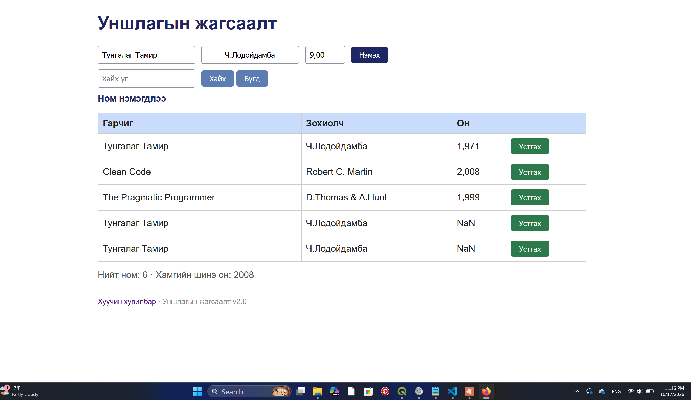

# BUG-02: Ижил гарчиг, зохиолчтой ном дахин нэмэгдэж, давхардал шалгагддаггүй

Орчин: Уншлагын жагсаалт v2.0, Firefox 144.0, Windows 11, Node v24.21.0, 2026-10-17
Урьдчилсан нөхцөл: node app.js-ийг шинээр асаасан (анхны 3 ном)

## Дахин гаргах алхам
1. http://localhost:3000 нээнэ (3 ном харагдана, тэдгээрийн нэг нь «Тунгалаг Тамир / Ч.Лодойдамба / 1971»).
2. Гарчиг: `Тунгалаг Тамир`, Зохиолч: `Ч.Лодойдамба`, Он: `9,00` гэж бөглөөд «Нэмэх» дарна.
3. Яг ижил утгуудаар дахин «Нэмэх» дарна.

Хүлээгдэж байсан: «Ижил гарчиг, зохиолчтой ном давхардуулж нэмэгдэхгүй» (спецификаци). Алдааны мессеж гарч, ном нэмэгдэхгүй байх ёстой.
Бодит үр дүн: Хоёр удаа хоёулаа нэмэгдэж, хүснэгтэд «Тунгалаг Тамир / Ч.Лодойдамба» гэсэн 3 мөр харагдсан (анхны 1 + шинэ 2). «Ном нэмэгдлээ» мессеж гарч, ямар ч анхааруулга өгөөгүй. Оныг өөрчилсөн ч, яг ижил утгаар нэмсэн ч давхардал шалгагдахгүй.
Ноцтой байдал: Major (өгөгдөл давхардаж, спецификацийн дүрэм зөрчигдөж байна)
Хавсралт: 
Олдсон аялал: Couch Potato
